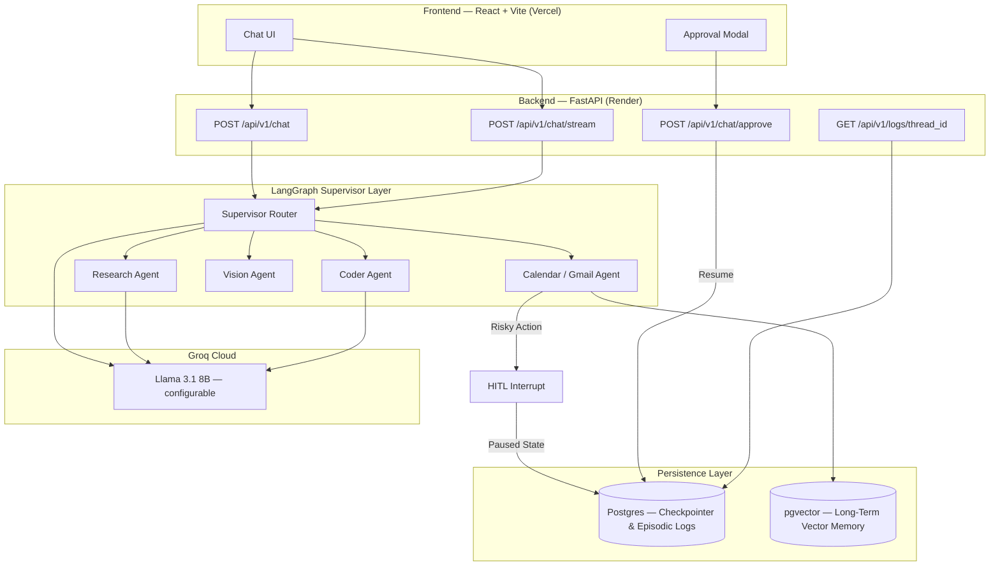
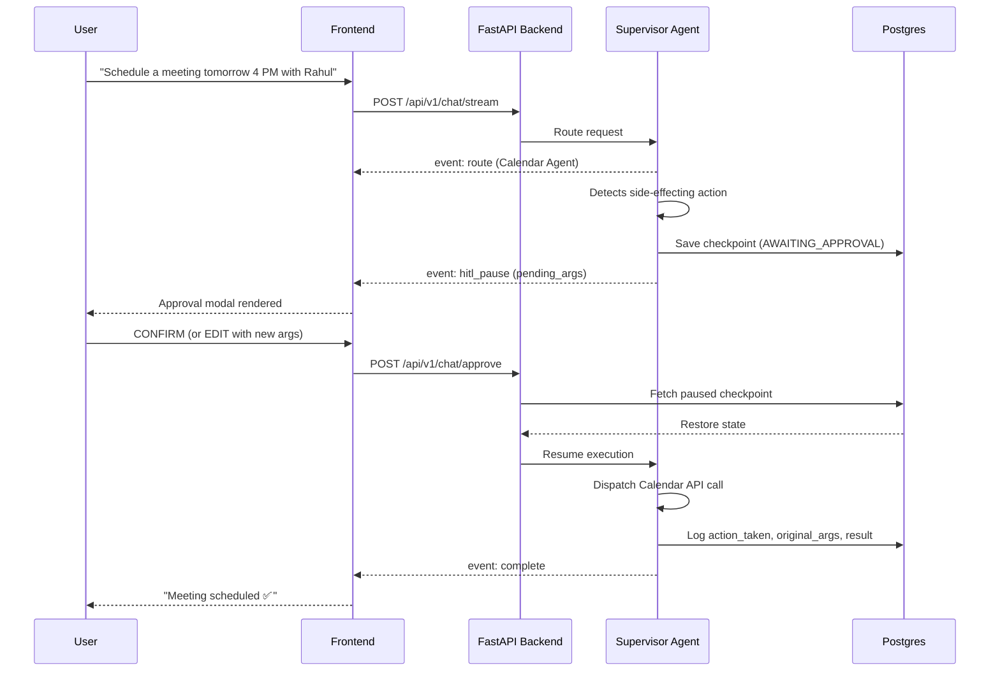

<div align="center">

# AgentOS Core 🤖

### Enterprise-Grade Multi-Agent Orchestration Platform

**A LangGraph-powered autonomous agent system with Supervisor routing, Human-in-the-Loop safety, persistent state, and real-time tool execution.**

<br/>

[](https://agentos-core-ssl7.onrender.com)
[](https://agentos-core-git-backend-ml-harsh28-rajs-projects.vercel.app?_vercel_share=xLagqJXb5Q6K60BTpE0kJqSJd69uZRIV)
[](https://www.python.org/)
[](https://fastapi.tiangolo.com/)
[](https://www.langchain.com/langgraph)
[](https://groq.com/)
[](https://neon.tech/)

[**Live Demo**](https://agentos-core-git-backend-ml-harsh28-rajs-projects.vercel.app?_vercel_share=xLagqJXb5Q6K60BTpE0kJqSJd69uZRIV) ·
[**API Docs (Swagger)**](https://agentos-core-ssl7.onrender.com/docs) ·
[**Developer Docs**](docs/README.md) ·
[**Report Bug**](https://github.com/Harsh28-raj/agentos-core/issues) ·
[**Request Feature**](https://github.com/Harsh28-raj/agentos-core/issues)

</div>

---

## Table of Contents

- [Overview](#overview)
- [Why Multi-Agent, Not a Single Chatbot?](#why-multi-agent-not-a-single-chatbot)
- [Key Features](#key-features)
- [System Architecture](#system-architecture)
- [Human-in-the-Loop Workflow](#human-in-the-loop-workflow)
- [Tech Stack](#tech-stack)
- [Project Structure](#project-structure)
- [Local Setup](#local-setup)
- [Environment Variables](#environment-variables)
- [API Overview](#api-overview)
- [Security](#security)
- [Known Limitations](#known-limitations)
- [Roadmap](#roadmap)
- [Author](#author)

---

## Overview

**AgentOS Core** is a Personal AI Operating System — an autonomous backend built on **LangGraph's** stateful graph model, where a **Supervisor Agent** reasons over incoming requests and routes them to specialized sub-agents (Research, Coder, Vision, Calendar, Gmail) rather than handling everything in one monolithic prompt.

Unlike a typical chatbot wrapper, AgentOS Core **remembers across sessions, executes real-world actions, pauses for human approval before anything risky, and logs a full audit trail of every decision it makes.**

The frontend is a custom-built, terminal-inspired dashboard — real-time tool status, live approval modals, and full light/dark theming — built to make the agent's reasoning process visible rather than hidden behind a spinner.

> [!TIP]
> Every "risky" action — sending an email, creating a calendar event — goes through an explicit human approval gate before it touches a real API. Nothing happens silently.

---

## Why Multi-Agent, Not a Single Chatbot?

Given a request like *"Check if I'm free tomorrow at 4 PM, and if so, email Rahul the invite,"* the Supervisor Agent:

1. Classifies intent and routes to the **Calendar Sub-Agent**
2. Detects that `create_calendar_event` is a side-effecting action and **pauses execution**, persisting full graph state to Postgres
3. Streams a `hitl_pause` event to the frontend with the pending tool call and arguments
4. Waits — for 5 seconds or 5 hours, it doesn't matter, state is durable
5. On human `CONFIRM` (or edited args via `EDIT`), resumes exactly where it left off and dispatches the real Gmail/Calendar API call
6. Logs the full decision trail — original args, human decision, final result — to the audit table

This **Reason → Route → Pause → Resume** loop is what separates an agentic system from a chatbot with API access.

---

## Key Features

<table>
<tr>
<td width="50%" valign="top">

#### Multi-Agent Orchestration
- Supervisor Router with dynamic sub-agent handoff
- 5 specialized tools live: Web Search, Weather, Code Interpreter, Calendar, Gmail — plus Vision and Document RAG
- Loop-prevention guardrail (max iteration cap)
- Token & cost tracking per LLM call

#### Real-Time Streaming
- Server-Sent Events at `/api/v1/chat/stream`
- Live status events: `thinking`, `route`, `tool_start`, `tool_end`, `token`, `hitl_pause`, `done`
- Frontend renders live "Routing to Coder Agent..." status, not a blank spinner

</td>
<td width="50%" valign="top">

#### Human-in-the-Loop Safety
- Every side-effecting action pauses for approval
- Three resolutions: `CONFIRM`, `REJECT`, or `EDIT` (override tool arguments before execution)
- State persisted in Postgres — survives restarts, no timeout on pending approvals

#### Memory & Auditability
- Short-term thread memory via LangGraph's Postgres checkpointer
- Long-term semantic memory via Postgres pgvector, private to each user (RAG over uploaded PDFs & images)
- Full episodic audit log — every tool call, latency, and human decision, queryable per thread

</td>
</tr>
</table>

#### Tool Suite
- 🌐 **Web Search** — Tavily API for live facts and news
- 🌦️ **Weather** — real-time conditions
- 🐍 **Code Interpreter** — Python execution for math, data, and logic (opt-in via `ENABLE_CODE_INTERPRETER`, see [docs/SECURITY.md](docs/SECURITY.md))
- 👁️ **Vision** — Groq vision model for image/diagram/receipt analysis, auto-synced to memory
- 📄 **Document RAG** — PDF upload, parsed and embedded into pgvector
- 📧 **Gmail Agent** — search, read, draft, and send email (draft-first, approval-gated, per-user Google OAuth)
- 📅 **Calendar Agent** — create events from natural language, HITL-approved

#### Frontend Experience
- Custom terminal-inspired UI (React + Vite + TailwindCSS)
- Full light/dark theme toggle with persisted preference
- Live tool connection status panel and episodic memory viewer
- Responsive, fluid layout across screen sizes

---

## System Architecture



---

## Human-in-the-Loop Workflow



---

## Tech Stack

| Layer | Technology |
|---|---|
| Backend Framework | FastAPI (async), Python 3.11+ |
| Agent Orchestration | LangGraph (Supervisor pattern), LangChain Core |
| LLM Inference | Groq Cloud — `llama-3.1-8b-instant` by default (`GROQ_MODEL`), vision via `GROQ_VISION_MODEL` |
| State & Checkpointing | PostgreSQL (Neon) via `AsyncPostgresSaver` |
| Long-Term Memory | PostgreSQL pgvector + FastEmbed |
| External Integrations | Gmail API, Google Calendar API, Tavily Search |
| Frontend | React 19, Vite, TailwindCSS 4 |
| Tests | pytest (fake LLMs, no keys needed) |
| Deployment | Render (backend), Vercel (frontend) |

---

## Project Structure

```text
agentos-core/
├── api-1/                     # FastAPI + LangGraph backend
│   ├── app/
│   │   ├── main.py            # App, CORS, lifespan (DB, checkpointer, graph)
│   │   ├── core/              # config, security (JWT/bcrypt/Fernet), auth deps, HITL helpers
│   │   ├── db/                # SQLAlchemy models, Postgres setup, pgvector memory
│   │   ├── ai/
│   │   │   ├── agents/        # supervisor + research/coder/vision/gmail/calendar agents
│   │   │   ├── tools/         # gmail, calendar, web search, weather, calculator, vision, code
│   │   │   ├── llm.py         # LLM factory, date context, safe context window
│   │   │   └── checkpointer.py
│   │   └── routers/           # auth, chat (+stream/approve/history), upload, logs, system, Google OAuth
│   ├── tests/                 # pytest suite
│   └── requirements.txt
├── frontend/                  # React + Vite SPA
├── docs/                      # Developer documentation (start at docs/README.md)
└── CLAUDE.md                  # Entry point for AI coding assistants
```

See [docs/BACKEND.md](docs/BACKEND.md) and [docs/FRONTEND.md](docs/FRONTEND.md) for a file-by-file map.

---

## Local Setup

### Prerequisites
- Python 3.11+
- Node.js 18+
- A PostgreSQL database (Neon or self-hosted)

### Backend

```bash
git clone https://github.com/Harsh28-raj/agentos-core.git
cd agentos-core/api-1

python -m venv venv
source venv/bin/activate      # Windows: venv\Scripts\activate
pip install -r requirements-dev.txt

cp .env.example .env
# Fill in GROQ_API_KEY, DATABASE_URL, JWT_SECRET_KEY, ENCRYPTION_KEY (see docs/CONFIGURATION.md)

uvicorn app.main:app --reload --port 10000
pytest                        # optional: run the test-suite (no API keys needed)
```

### Frontend

```bash
cd frontend
npm install
cp .env.example .env.local
npm run dev
```

| Service | URL |
|---|---|
| Backend (Swagger UI) | http://localhost:10000/docs |
| Frontend | http://localhost:5173 |

---

## Environment Variables

| Variable | Required | Description |
|---|:---:|---|
| `GROQ_API_KEY` | ✅ | Groq inference API key |
| `DATABASE_URL` | ✅ | Postgres connection string (users, audit logs, checkpoints, pgvector memory) |
| `JWT_SECRET_KEY` | ✅ | JWT signing secret (sessions reset on restart if unset) |
| `ENCRYPTION_KEY` | ✅ for Google | Fernet key for stored Google tokens |
| `TAVILY_API_KEY` | | Live web search |
| `GOOGLE_CLIENT_ID` / `GOOGLE_CLIENT_SECRET` / `GOOGLE_REDIRECT_URI` | for Google | Per-user Gmail & Calendar OAuth ("Connect Google" button) |
| `CORS_ORIGINS`, `FRONTEND_URL`, `DEFAULT_TIMEZONE`, `ENABLE_CODE_INTERPRETER`, … | | See [docs/CONFIGURATION.md](docs/CONFIGURATION.md) |

> [!WARNING]
> Never commit `.env`, `credentials.json`, or `token.json` — all three are covered by `.gitignore`.

---

## API Overview

All endpoints except register/login require `Authorization: Bearer <token>`.

| Method | Endpoint | Description |
|---|---|---|
| `GET` | `/` | Health check |
| `POST` | `/api/v1/auth/register` · `/api/v1/auth/login` · `GET /api/v1/auth/me` | Account & JWT |
| `POST` | `/api/v1/chat` | Synchronous agent chat |
| `POST` | `/api/v1/chat/stream` | Real-time SSE streaming (thinking/route/tool/token/hitl_pause/done events) |
| `POST` | `/api/v1/chat/approve` | Resume a paused action — `CONFIRM`, `REJECT`, or `EDIT` |
| `GET` / `DELETE` | `/api/v1/chat/history/{thread_id}` | Conversation (+ pending approval) / delete it |
| `POST` | `/api/v1/upload` | Upload PDF or image — parsed and embedded into the user's memory |
| `GET` | `/api/v1/logs/{thread_id}` | Episodic audit trail for one of your threads |
| `GET` | `/api/v1/system/status` | Live tool and integration status |
| `*` | `/api/v1/integrations/google/...` | Connect / disconnect Google (OAuth) |

Full reference: [docs/API.md](docs/API.md) · Interactive docs: **[agentos-core-ssl7.onrender.com/docs](https://agentos-core-ssl7.onrender.com/docs)**

---

## Security

- Every endpoint is authenticated; the user id always comes from the JWT, and conversations, audit logs, memory, uploads and Google tokens are isolated per user
- API keys and OAuth secrets come from environment variables only; Google tokens are encrypted at rest (Fernet)
- Draft-first policy on outbound email, and `send_email` / `create_calendar_event` always pause for explicit approval
- Approval replies are parsed conservatively: any negative ("no", "don't", "cancel") rejects, anything unclear ("maybe", "wait") asks again
- The code interpreter is disabled unless `ENABLE_CODE_INTERPRETER=true` — see [docs/SECURITY.md](docs/SECURITY.md)

---

## Known Limitations

- **Code interpreter is not a true sandbox** — keep it off for multi-user deployments.
- **No rate limiting or refresh tokens yet** — see [docs/SECURITY.md](docs/SECURITY.md).
- **Uploaded images are stored on local disk** — they need a persistent disk on Render.
- **Small default model** — `llama-3.1-8b-instant` can mis-route; guardrails cap and correct routing, and `GROQ_MODEL` can be raised.
- **Render free-tier cold starts.** First request after inactivity can take 30–40 seconds.

Full audit and status: [docs/BUG_AUDIT.md](docs/BUG_AUDIT.md)

---

## Roadmap

- [x] Managed Postgres vector store (`pgvector`) for persistent long-term memory
- [x] Multi-tenant OAuth — per-user encrypted Gmail/Calendar tokens
- [x] Calendar "Check Availability" tool
- [x] Cross-agent tool chaining (supervisor loop with hop limit)
- [ ] Isolated sandbox for the code interpreter
- [ ] Rate limiting and refresh tokens
- [ ] Thread list / conversation sidebar
- [ ] Voice interface (Whisper API)
- [ ] Local LLM fallback (Ollama) for privacy-sensitive sessions

---

## Author

<div align="center">

**Harsh Raj**

[](https://github.com/Harsh28-raj)
[](https://linkedin.com/in/harsh-raj4308g)

If you find this project useful, consider giving it a star ⭐

</div>
